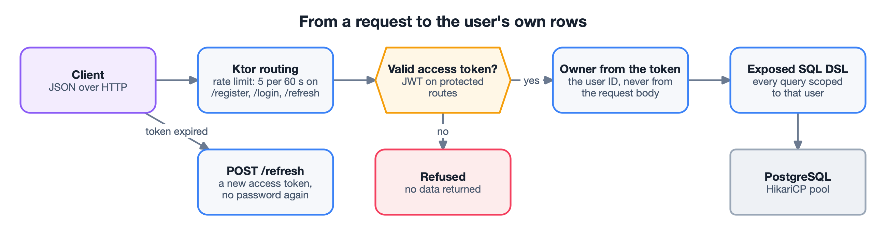
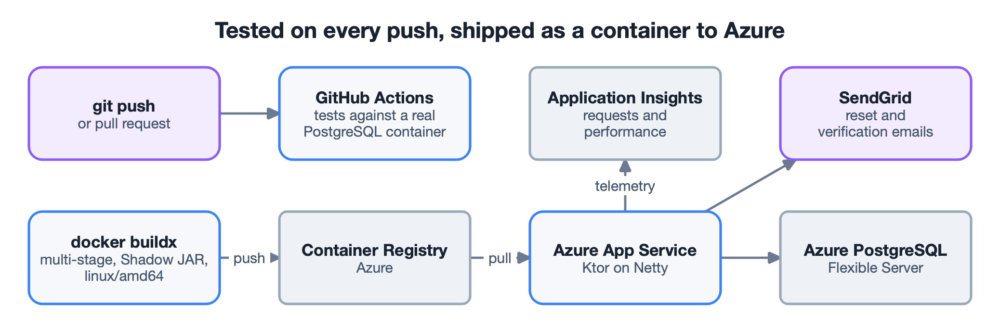

## The problem

It started as a way to learn backend development in Kotlin, and ended up touching every
layer of a production-style API: routing, persistence, authentication, authorization,
containers and a cloud deployment. The core rule: many users share one database, and each
user can see and change only their own expenses.

## What it does

- **Expenses.** Full CRUD over a real PostgreSQL database, through Exposed's SQL DSL and a
  HikariCP connection pool.
- **Accounts.** Registration with BCrypt-hashed passwords, and login that issues a
  short-lived access token and a longer-lived refresh token.
- **Self-service email flows.** Password reset and email verification through single-use,
  expiring tokens sent by SendGrid.
- **Abuse limits.** `/register`, `/login` and `/refresh` accept 5 requests per 60 seconds
  per client.

## Key decisions

**Identity comes from the token, never from the request.** Protected routes take the user
ID from the verified JWT and scope every query to it. Nothing the client sends can widen
that scope.

**A reset endpoint that gives nothing away.** `/forgot-password` returns the same answer
whether or not the account exists, so it cannot be used to find registered usernames. A
reset token is invalidated as soon as it is used, whatever the result.

**Verification tracked, not enforced.** A new user can log in before verifying the email;
the `verified` flag is kept on the user, so actions can be limited to verified users
later without locking anyone out now.

**Tests against the real engine.** The integration tests run against PostgreSQL in a CI
service container instead of a mocked database – slower to set up, but they test what
production runs.

## Problems solved on the way

- **The container skipped the database set-up.** The Shadow JAR used Ktor's `EngineMain`
  as its entry point, which bypassed my own `main()` and its `DatabaseFactory.init()`.
  Setting the manifest's `Main-Class` explicitly fixed it.
- **"localhost" inside a container.** The hard-coded JDBC URL pointed at the container
  itself. All database settings moved to environment variables – the same code now runs
  locally, in Docker and on Azure.
- **An architecture error reported as an authorization error.** Azure said "check registry
  credentials", but the raw logs showed no `linux/amd64` image: it had been built on Apple
  Silicon. Rebuilding with `docker buildx --platform linux/amd64` fixed it.
- **Credentials silently ignored.** A managed-identity flag left by the portal wizard made
  App Service skip the registry credentials. Recreating the service from a clean state with
  the Azure CLI removed the conflict.
- **An email that "succeeded" but never arrived.** A stray character in the SendGrid key
  caused a 401 that the deliberately uniform reset response hid; it showed only in the
  server log. A reminder that a successful call and the intended result are different
  claims.
