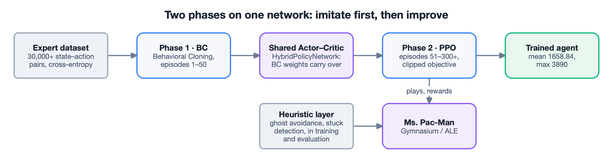
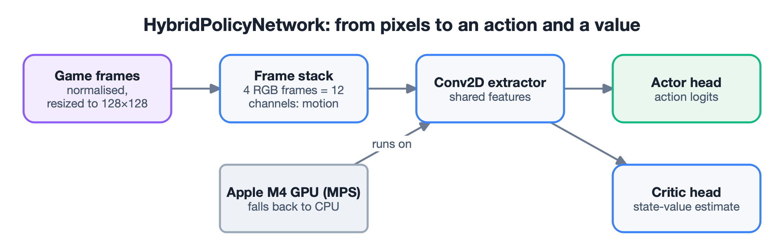
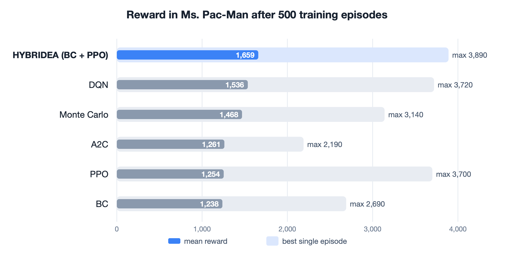

## The problem

Reinforcement learning from a cold start is slow and unstable: an agent explores at random
and makes the same mistakes for a long time before it improves. Imitation learning starts
well but stops at the level of the expert it copies. The thesis asked whether a hybrid of
the two can learn level-completion strategies faster and better than either – using
Ms. Pac-Man as the test environment for NPC behaviour in games.

## What I built

Six agents, implemented and benchmarked under the same conditions: DQN, PPO, A2C, Monte
Carlo, Behavioral Cloning, and the project's own contribution, HYBRIDEA.

- **Phase 1 – Behavioral Cloning (episodes 1–50).** The agent learns from 30,000+ expert
  state–action pairs with a cross-entropy loss, so it navigates safely from the start
  instead of exploring at random.
- **Phase 2 – PPO (episodes 51–300+).** The same network keeps training by playing, with
  PPO's clipped objective and advantage estimation, so it can improve on the expert instead
  of only copying it.
- **A heuristic layer** – ghost avoidance and stuck-state detection – keeps behaviour stable
  in both training and evaluation.

## The network

`HybridPolicyNetwork` is a shared Actor–Critic. Game frames are normalised, resized to
128×128 and stacked four at a time into 12 channels, which gives the model motion context.
A Conv2D feature extractor feeds two heads: the Actor gives the action logits, the Critic
estimates the value of the state. Training runs on the Apple M4 GPU through Metal
Performance Shaders and falls back to the CPU.

## Results

HYBRIDEA had the best mean reward of all six agents – about 8% above DQN, the strongest
single method, and about 32% above plain PPO – and also the highest single-episode score.
It scored above the Behavioral Cloning agent built from the same expert data, which is the
point of the hybrid: the demonstrations are a starting line, not a ceiling.

## Engineering

- **A reproducible pipeline.** One entry point selects the algorithm and the device; the
  pipeline saves checkpoints, logs runs, plots loss and reward curves, and writes
  evaluation reports.
- **Fair comparison.** Every agent trained for 500 episodes and was measured on the same
  metrics: mean and max reward, reward distribution, step consistency and score variance.
  Each model took about 2–3 hours to train on a Mac mini M4.
- **Custom environment.** A Gymnasium-compliant Ms. Pac-Man environment over the Arcade
  Learning Environment, with reward logic and maze configuration in YAML.
