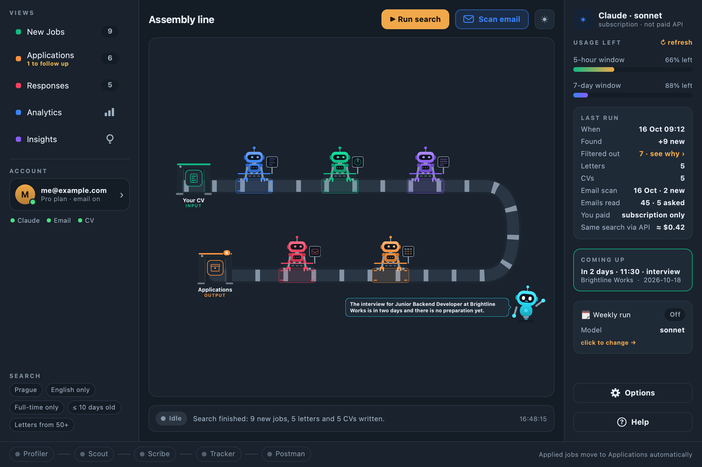
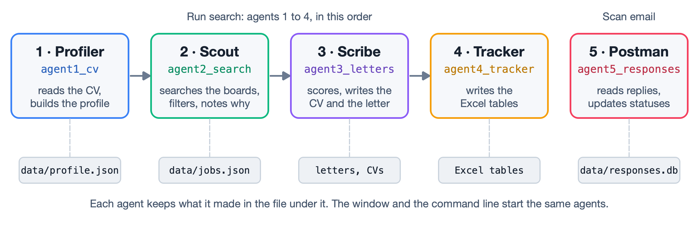
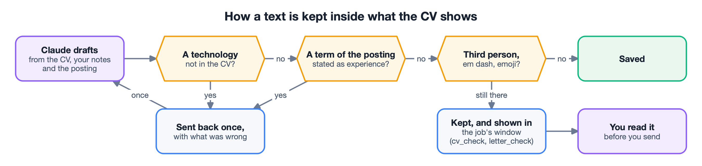
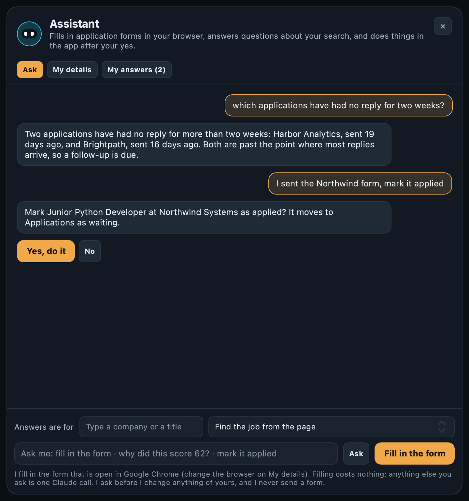
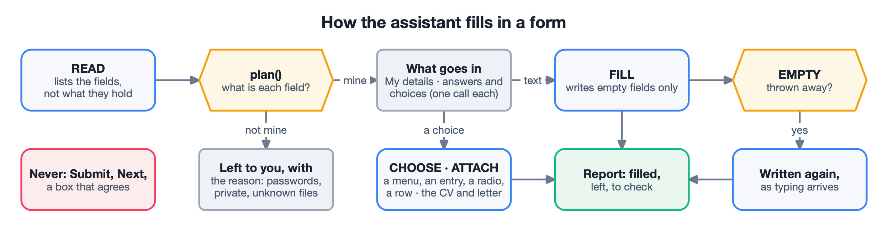
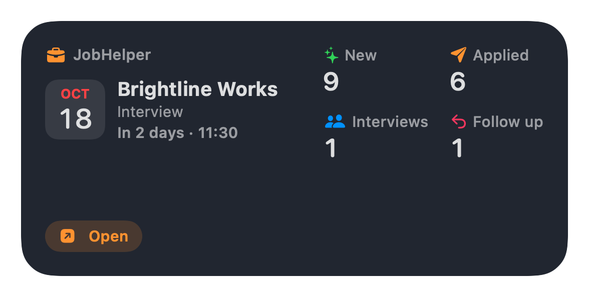

## The problem

A job search repeats the same work for every posting: read it, decide whether it fits, rewrite
the CV and a letter, type the same details into each company's form, keep a list of
applications, and read the replies. I wanted a tool that does the repetitive part and leaves
every decision to the person – and that never sends anything in their name.

## What it does

- **Search and scoring.** Reads jobs.cz, prace.cz, LinkedIn's public pages, company career
  sites and remote boards. Plain-code filters (language, level, years, location, duplicates)
  run before any model call, so a search of several hundred postings costs a few dozen calls.
  Each posting gets a 0–100 score with the reason in words.
- **Documents per job.** An adapted CV and a cover letter in the person's own Word layout,
  written by Claude and then checked against the master CV.
- **Applications tracked by email.** Replies are read from the mailbox (read-only over IMAP),
  classified, and filed to the right application.
- **An assistant that fills forms.** It writes into the empty fields of an application form in
  the person's own browser, and never presses Submit.

## Key decisions

**The model proposes, the code decides.** A prompt that says "do not invent" is not a
guarantee. Every adapted CV, letter and form answer is checked after the model wrote it: a
term of the posting stated as experience that the CV does not support is sent back once, and
whatever remains is shown to the person instead of being silently removed.

**A free request is decided by Claude but carried out by the app.** The assistant's answer
comes back as text or as up to three actions from a fixed list. The app checks them, asks the
person in its own words, and changes nothing before a yes. Tests with forged replies confirm
that none of them can change data.

**Filling a form without risk.** Small scripts list the fields without reading their values,
plain code decides what each field is, and the values travel as data, never as code. The one
script that presses anything accepts five kinds of element and re-reads their words first.

**Private by design.** The job list, settings and replies are encrypted with AES-256-GCM, with
the key in the macOS Keychain; rule files are signed, so a change made outside the app must be
approved. The mailbox is only ever read.

## Engineering

- **Native Mac app.** A Qt Quick interface packaged with PyInstaller, and a desktop widget in
  Swift/WidgetKit that reads only a small summary – never the encrypted data. Building it
  without Xcode meant finding out why the widget exited at once on macOS 26 (it must start in
  `NSExtensionMain`) and why it showed nothing (inside the sandbox, "home" is the widget's own
  container).
- **Measured, not guessed.** Rules that skip work were measured on real data before they
  shipped: on 150 days of real mail, the email filter asks the model about 242 messages
  instead of 661, and no filed reply is lost.
- **Tested like a product.** 1,900+ offline tests in temporary folders, including the window
  itself and a test area of real forms in a real browser engine. GitHub Actions runs them on
  macOS after every push, and a pre-push check stops anything private from being published.

