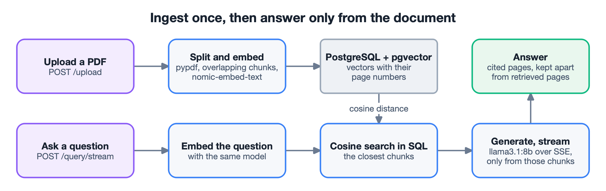
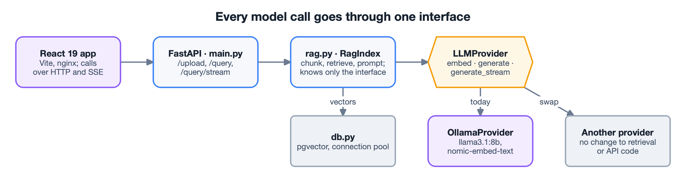

## The problem

A language model answers from its training data, so it can be confidently wrong about a
specific document. Retrieval-augmented generation fixes this: find the passages of the
document that matter, and let the model answer only from them. I wanted the whole pattern
end to end, as a small full-stack application where no document data ever leaves the
machine.

## How it works

- **Ingest.** An uploaded PDF is read page by page and split into overlapping chunks. Each
  chunk is embedded and stored in PostgreSQL with pgvector, together with its page number,
  so the vectors survive a restart.
- **Retrieve.** A question is embedded with the same model, and a cosine-similarity search
  inside the database returns the closest chunks.
- **Generate.** The chunks go into the prompt with one instruction: answer only from them
  and cite the pages. When the document does not hold the answer, the model declines
  instead of inventing one.
- **Stream.** The answer reaches the browser token by token over Server-Sent Events.

## Key decisions

**The model layer is an interface, not a hard-coded call.** `LLMProvider` defines `embed`,
`generate` and `generate_stream`; `OllamaProvider` implements them. Retrieval and the API
depend only on the interface, so the backend can move from a local model to a hosted one
without touching either.

**Honest citations.** Reporting every retrieved page would overstate the sources. The
service reads the pages the answer actually referenced and returns them apart from the
wider set that retrieval pulled in – `cited_pages` and `retrieved_pages`.

**Streaming from a POST endpoint.** The browser's `EventSource` supports only GET, and the
question belongs in a POST body. The frontend reads the response body as a stream and
parses the SSE frames itself.

**Search where the data lives.** pgvector's cosine-distance operator runs the
nearest-neighbour search in SQL instead of loading every vector into the application, and a
connection pool reuses database connections across requests.

## Engineering

- **One-command stack.** `docker compose up` starts the database, the models, the FastAPI
  backend and the React frontend (a multi-stage build served by nginx).
- **Configurable, with working defaults.** The database URL, the Ollama host, CORS origins
  and the frontend's API address come from environment variables.
- **Tested in CI.** The tests mock the model and the database, so they run without Ollama or
  PostgreSQL; GitHub Actions lints and tests the backend and builds the frontend on every
  push.
