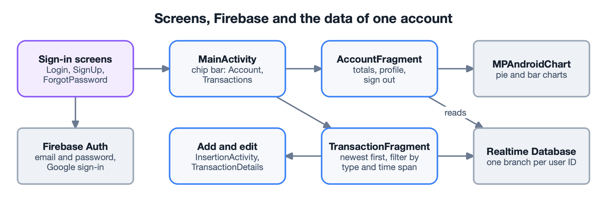

## The goal

An everyday finance tracker with a clean interface, where recording a transaction takes
only a few taps, the balance between money earned and money spent is visible at a glance,
and the data follows the account across devices.

## What it does

- **Accounts.** Sign-up and login with email and password or with Google, email
  confirmation, password recovery, sign-out and a custom profile picture.
- **Transactions.** Add income or expenses with an amount, category, date and description;
  edit or delete them later.
- **History.** The list shows the newest first and filters by type and time span.
- **Insight.** Totals for the selected period and pie and bar charts that compare spending
  with income.

## How it is built

**Firebase as the whole back end.** Firebase Authentication handles the accounts, including
Google sign-in. Each user's transactions live in their own branch of the Realtime Database,
under the user ID, so one account never reads another's data and the same data appears on
every device.

**Live data on screen.** The transaction list listens to the database, so a change shows
up without a manual refresh; the account screen also refreshes with a swipe.

**Screens split by job.** A main activity with a chip bar switches between an account
fragment and a transactions fragment; adding and editing a transaction have their own
screens. The charts are drawn with MPAndroidChart.

## Testing

Functional test cases covered registration, login, adding, editing, deleting and sorting
transactions, and synchronization, comparing the real behaviour with the written
requirements. All passed.
