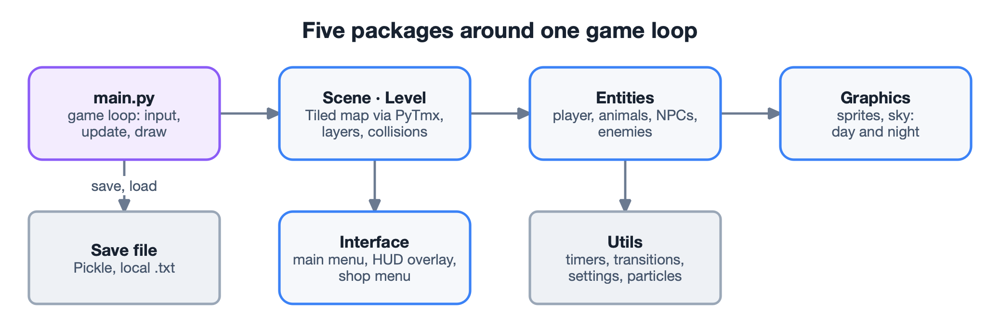

## The idea

A single-player 2D adventure in the spirit of *Stardew Valley*, *Terraria* and *Staxel*: the
player grows crops, raises animals, fights enemies, builds, trades and follows a story,
while the game keeps track of progress between sessions.

## What it does

- **Farming and animals.** Planting, growing and harvesting crops; animals and plants have
  their own behaviour and care cycles.
- **Combat and rewards.** Enemies to fight, and rewards to collect.
- **Economy.** Resources, money and a trading shop.
- **Story.** Objectives and quests with tracked progress.
- **A living world.** A day/night cycle that affects play, weather, and smooth transitions
  between menus and gameplay.
- **Saves and settings.** Progress is saved to and loaded from a local file; resolution and
  volume are kept in data files.

## How it is built

**Five packages, one loop.** `main.py` runs the game loop – input, update, draw – every
frame. Scene loads the level from a Tiled map through PyTmx, with its layers, collisions and
the shop; Entities hold the player, animals, NPCs and enemies; Graphics draws the sprites and
the sky; Interface holds the menus and the HUD; Utils holds timers, transitions, settings
and particles.

**Patterns where they pay off.**

- **Game Loop** drives the update and render cycle.
- **State** changes how the player, animals and enemies behave as the game runs.
- **Composite** lets one object and a group of objects – a tree and the fruit it gives – be
  treated the same way.
- **Decorator** adds behaviour, such as assigning animals to buildings, without changing
  the classes.

**Simple persistence.** Save files are serialized with Pickle to local files, so the game
needs no network and keeps all data on the player's machine.

## Testing

A set of 27 functional test cases checked the game against its requirements: a new game,
saving and loading, the menus, farming and harvesting, animal care, trading, quests and
content updates. All 27 passed.
